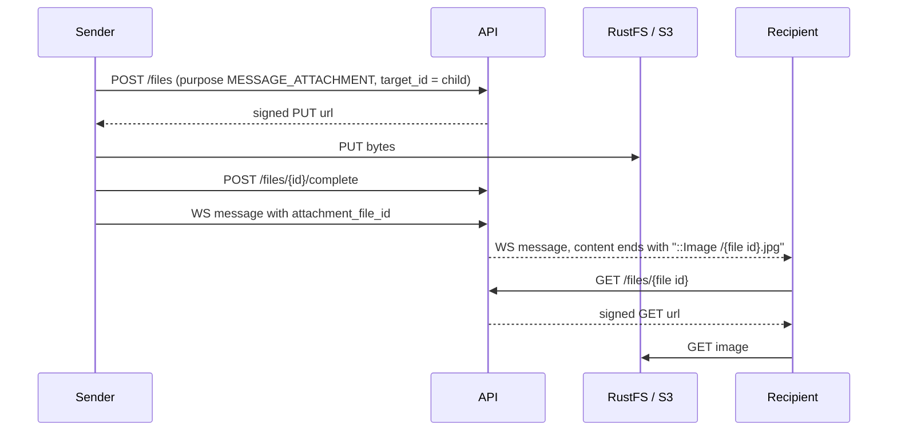

# Live chat

One chat per child. Its people are the child's **PADRE**, the **DOCENTE** of the child's salon and the **ADMIN** of the child's estancia.
Messages are **sent** over a WebSocket, **read** (history) and **deleted** over REST.

| What | How |
|---|---|
| Send, live delivery | `WS /ws/chat` (this page; WebSocket routes are not in OpenAPI) |
| History, oldest first | `GET /messages?child_id=&since=` (`since`: timestamp with timezone, see below; `include_deleted=true`: ORG only) |
| Delete (PADRE only, any message of their child's chat, soft) | `DELETE /messages/{id}` |

Rules: only PADRE and DOCENTE send; messages are never edited; ADMIN reads and receives but doesn't send; ORG reads through REST and is not a live participant.

## Connecting

`Authorization: Bearer <session token>` on the handshake (OkHttp: `Request.Builder().header(...)`). The token is checked like any REST call
(valid, not pending, role has `message:read`). If it isn't, the server accepts and closes with code **4401**: refresh the token (`POST /auth/refresh`) and reconnect.
When the server is ready it sends `{"type":"ready"}`; messages are delivered from then on.

The session token lasts 5 minutes and so does the socket's authentication: before it expires send `{"type":"auth","token":"<fresh token>"}` (same user)
and the server answers `{"type":"auth_ok"}`. Otherwise it closes with **4401** at expiry. Role, salon or child changes apply on the **next message**,
because access is read from the database for every frame.

## Frames (JSON, one object per text frame)

| Direction | Frame |
|---|---|
| client → server | `{"type":"message","id":"<uuid>","child_id":"<uuid>","content":"Hola","sent_at":"2026-05-01T09:30:00Z","is_aviso":false,"attachment_file_id":null}` |
| server → sender | `{"type":"ack","id":"<uuid>","created":true,"message":{...MessageOut}}` |
| server → sender | `{"type":"error","id":"<uuid>"|null,"status":403|404|409|422|429,"detail":"..."}` (the socket stays open) |
| server → the others | `{"type":"message","message":{...MessageOut}}` (every device of every participant except the one that sent it) |
| server → participants | `{"type":"deleted","id":"<uuid>","child_id":"<uuid>"}` |
| both | `{"type":"ping"}` → `{"type":"pong"}` |

**Keepalive:** send a `ping` about every 30 s. A socket with no frame for 90 s (`CHAT_IDLE_SECONDS`) is closed with code **4408**, so a phone that lost its connection stops counting as online (and gets pushes instead); just reconnect and catch up with `since`. The same ping keeps Cloudflare/nginx from dropping an idle connection.

`id` is generated by the client and makes sending **idempotent**: sending the same message again (offline queue retry) is acked with
`created:false` and not delivered twice; a different body under the same id is a `409`. Messages the client sent while the socket was down are simply sent again after reconnecting;
after reconnecting it catches up with `GET /messages?child_id=...&since=<created_at of the newest message it has>`: `since` filters on the time the **server** stored the message (`created_at`), not on the client's `sent_at`, so messages sent late from an offline phone aren't skipped. Messages deleted while it was away are not listed there; refetch the whole chat now and then to drop them (the socket has no replay).
Limit: 60 messages per minute per user.

## Photos

The stored `content` is plain text. In every frame and in `GET /messages` a message with a photo has a **last line** `::Image /<file id>.<ext>`
(or just that line if the text is empty). The client strips the line, takes the uuid and asks `GET /files/{id}` for the signed URL.
The extension is only informative. One photo can be attached to one message.

## Limits

* The hub of connected sockets is in memory: **run a single uvicorn process** (no `--workers`). Several processes/containers would need a shared
  fan-out (Postgres `LISTEN/NOTIFY` or Redis) behind `app/chat/hub.py`; `NOTIFY` does not store anything, so history still comes from `GET /messages`.
* The proxy in front (Cloudflare / nginx) must pass WebSocket upgrades (`Upgrade` and `Connection` headers; nginx `proxy_http_version 1.1`, a long `proxy_read_timeout`).
  The app needs `uvicorn[standard]` (it brings `websockets`).
* Participants with no socket open get a push notification, see [push.md](push.md).
* `CORS` doesn't apply to sockets; the app isn't a browser, so there is no origin check.
