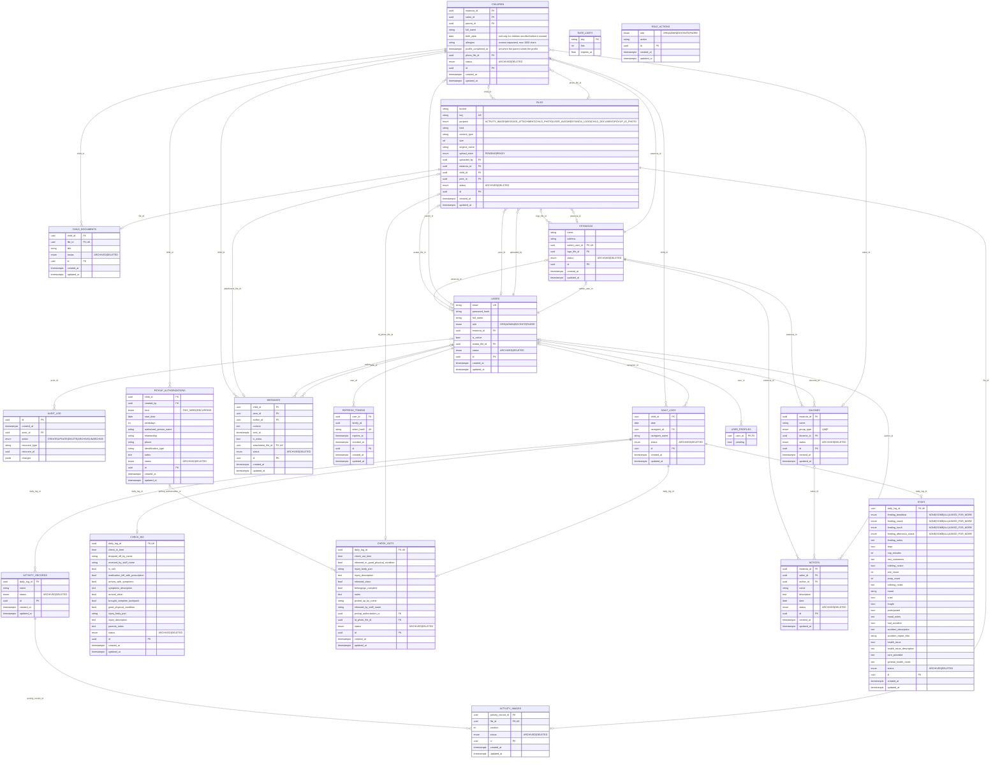

# Sonrisas database

PostgreSQL. Models: `backend/app/database/models.py`. Schema changes: [migrations.md](migrations.md).

Notes on the diagram: `rate_limits`, `refresh_tokens`, `device_tokens` (FCM push registrations), `role_actions` and `user_profiles` are bookkeeping for auth.
`ACTIVITY_IMAGES`, `MESSAGES`, `USERS`, `ESTANCIAS` and `CHILDREN` point at `FILES` for their images; `FILES` points back
at the user, estancia and child it belongs to (those foreign keys are added after the tables exist, because the
references go in a circle).

## Pickup authorizations

Who besides the parent may pick a child up (`app/pickups.py`). `weekdays` is a bitmask (Monday = 1 ... Sunday = 64):

- `THIS_WEEK`: those days of one week only; `start_date` is its Monday. Days already past can't be added. It is
  no longer listed once the week is over.
- `RECURRING`: those days of every week from `start_date` (the day it was created) until the parent cancels it.

At most one applies per child and day: a `THIS_WEEK` one wins over a `RECURRING` one on its days, and two of the
same kind that share a day are refused (409, or `?replace=true` cancels the old ones). "Today" and "this week" are
in `LOCAL_TIMEZONE` (default `America/Mexico_City`). A check-out to an authorized person stores
`pickup_authorization_id` and requires `id_photo_file_id` (a `PICKUP_ID_PHOTO` the DOCENTE takes).

## Nothing is ever deleted

Every domain table (everything except the auth bookkeeping above) has a nullable `status` column:

| `status` | Meaning | Visible to | Editable |
|---|---|---|---|
| `NULL` | active | everyone with access | yes |
| `ARCHIVED` | kept and listed, e.g. a child who graduated | everyone with access | no (`409`) until unarchived |
| `DELETED` | removed | **ORG only** (`?include_deleted=true`) | no |

* **The API never issues `DELETE`.** `DELETE /x/{id}` sets `status = 'DELETED'`.
* **The database enforces it.** A `BEFORE DELETE` row trigger and a `BEFORE TRUNCATE` trigger (`forbid_delete()`) on
  every one of those tables raise an error, so not even a bug, a script or a hand-typed `DELETE` can destroy a record.
  Foreign keys are `ON DELETE RESTRICT` (or `SET NULL` where a missing link is fine) for the same reason.
* **A parent can't be deleted while it has *active* dependents** (`409`): a salon with children, an estancia with
  salones, a child with daily logs, messages or documents, a user who still runs an estancia / teaches a salon /
  has children. `ARCHIVED` and `DELETED` dependents don't block. Parts that belong to a record are deleted with it:
  a daily log takes its check-in, stay, check-out, activities and photos along.
* **Unique values ignore deleted rows.** `users.email`, a salon's name inside its estancia, a child's log for a day,
  an estancia's admin and the 1:1 stage tables use partial unique indexes
  (`... WHERE status IS DISTINCT FROM 'DELETED'`), so a deleted salon's name or a deleted user's email can be used again.
  `ARCHIVED` rows still hold their values.
* **Files are kept too.** A deleted file only changes `status`; the object stays in RustFS. Only ORG can still get a
  download URL for it.

## Audit log

`audit_log` is append-only (a trigger rejects `UPDATE`, `DELETE` and `TRUNCATE`). One row per change of any record:

| column | |
|---|---|
| `actor_id` | the signed-in user who made the change; `NULL` = the system (startup seeding, expiry of unconfirmed uploads) |
| `action` | `CREATE`, `UPDATE`, `DELETE` (soft), `ARCHIVE`, `UNARCHIVE` |
| `resource_type`, `resource_id` | the table and the row |
| `changes` | on create the values set; on update `{"field": [old, new]}` for the fields that changed |
| `created_at` | when |

It is written by a SQLAlchemy `before_flush` hook (`app/database/audit.py`) in the **same transaction** as the change, so
either both are saved or neither is. `password_hash` is stored as `***`. Only changes made through the ORM are seen,
so records must never be changed with a bulk `UPDATE` statement. **The log holds copies of what was written** (chat messages, health notes of a stay...), so it is as sensitive as the tables themselves: don't expose it to anyone who couldn't read the originals. There is no endpoint for reading the log yet; it is
queried in SQL. Each change is also written to the API's stdout as a JSON line, without the values
(see [observability.md](observability.md)).

## Access model

Who can *reach* which rows (`app/auth/access.py`, resolved from the database on every request):

| Role | Reaches |
|---|---|
| **ORG** | everything, including deleted rows. Creates estancias and their admins. |
| **ADMIN** | its estancia (`estancias.admin_user_id`) and every salon, child and person in it. |
| **DOCENTE** | its estancia (`users.estancia_id`) and the salones where `salones.docente_id` is them, with those salones' children. |
| **PADRE** | its children (`children.parent_id`), their salones, and its estancia (`users.estancia_id`). |

A child has exactly one parent account (`children.parent_id`); a parent can have several children. DOCENTEs and PADREs
get `users.estancia_id` from the admin who created them. Every `/children` response carries `parent_name` (read-only, the parent's
`full_name`), so a DOCENTE sees who the parent is without `user:read`. `DELETED` rows drop out of these sets; `ARCHIVED` ones stay.

What each role may *do* with what it reaches is the `role_actions` table (see [auth.md](auth.md)) plus a few rules
written in code (only the parent or the admin deletes chat messages, only the docente of the salon uploads activity photos...).
