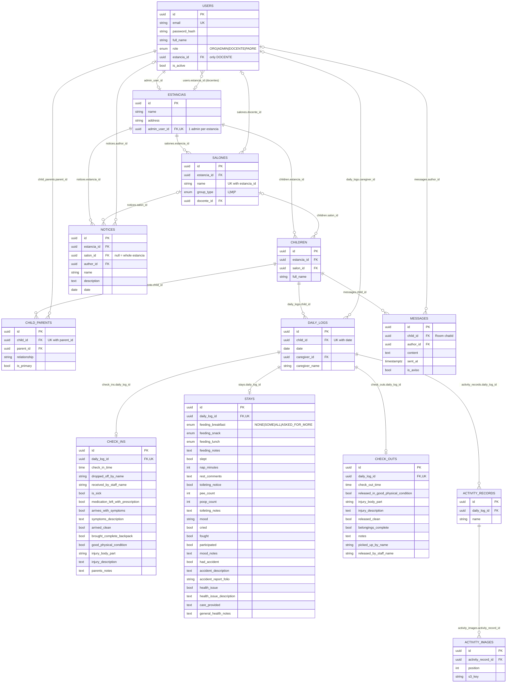

# Sonrisas database

## Access model
- **ORG**: Reads across all estancias, just overall states.
- **ADMIN**: the user in `estancias.admin_user_id`. Manages that estancia.
- **DOCENTE**: `users.estancia_id`, and assigned to salones via `salones.docente_id`.
- **PADRE**: no direct estancia or salon. Reached through `child_parents` to `children`, then `estancia_id` / `salon_id` by join.

