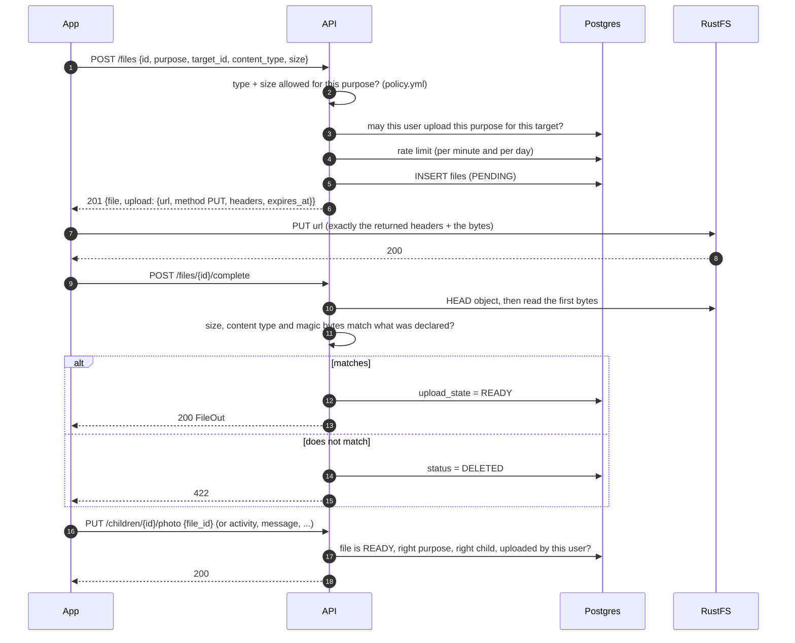
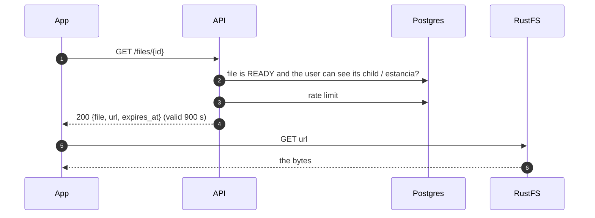

# Files and storage (RustFS)

Files never pass through the API: it hands out signed URLs for RustFS and decides who may upload or download what.
Code: `backend/app/storage/` and `backend/app/routers/files.py`. Other tables reference files by `files.id`, never by path.

## What can be uploaded

| Purpose | Who uploads | `target_id` | Bucket | Formats | Attached with |
|---|---|---|---|---|---|
| `ACTIVITY_IMAGE` | the **DOCENTE** of the child's salon | the child | `images` | jpeg, png, webp | `PUT /activities/{id}` (`image_file_ids`) |
| `MESSAGE_ATTACHMENT` | the child's **PADRE** or **DOCENTE** | the child | `images` | jpeg, png, webp | chat socket message (`attachment_file_id`), see [chat.md](chat.md) |
| `CHILD_PHOTO` | the child's **PADRE** | the child | `images` | jpeg, png, webp | `PUT /children/{id}/photo` |
| `USER_AVATAR` | the user, for **themself** | - | `images` | jpeg, png, webp | `PATCH /users/me` |
| `ESTANCIA_LOGO` | the estancia's **ADMIN** | the estancia | `estancias` | jpeg, png, webp | `PUT /estancias/{id}` (`logo_file_id`) |
| `CHILD_DOCUMENT` | the child's **PADRE** | the child | `files` | pdf, docx, jpeg, png, webp (a scan) | `PUT /documents/{id}` |

Limits: images 5 MB, pdf / docx 10 MB (`policy.yml`; defaults from `STORAGE_MAX_IMAGE_BYTES` / `STORAGE_MAX_FILE_BYTES`).
Nothing else is accepted: no gif, svg, html, zip or executables.

Who can **download** (`GET /files/{id}`): anyone who can see the child (their parent, the docente of their salon, the
estancia's admin, ORG) for files tied to a child; everyone in the estancia for its logo and for avatars of its people;
ORG for everything. Deleted files: ORG only.

## Uploading

What protects each step:

* **The signed URL pins the object.** The signature covers the bucket, the key, `Content-Type` and `Content-Length`. Changing any of them, or the key, makes RustFS answer `403`. The app must send exactly the `headers` it was given. The URL expires after 300 s. Objects are private: without a signature there is no access, and no listing.
* **The client's id makes retries safe.** Asking again with the same `id` and the same details returns a fresh URL (`200`) instead of a second file; a different request with a used id is a `409`.
* **`complete` is the proof.** Until the server has seen the object and checked its first bytes (`FFD8FF` jpeg, `89504E47` png, `RIFF....WEBP`, `%PDF-`, `PK\x03\x04` docx), the file stays `PENDING` and cannot be attached or downloaded. A pdf renamed to `.jpg` is rejected here.
* **Attaching re-checks everything** (`load_attachable`): the file is `READY`, not deleted, has the right purpose, belongs to the same child / estancia, and was uploaded by the same user where that matters. One photo can belong to one activity / message / document only.
* **Unconfirmed uploads expire.** Files still `PENDING` after the URL's lifetime plus a minute are marked `DELETED` (by the system, in the audit log) when the API starts and whenever someone asks for a new upload.
* **Rate limits** are per user, counted in Postgres (fixed windows): uploads 10/minute and 200/day, downloads 300/minute by default (`policy.yml`, or `STORAGE_UPLOAD_PER_MINUTE`, `STORAGE_UPLOAD_PER_DAY`, `STORAGE_DOWNLOAD_PER_MINUTE`). A request that is refused for permissions or validation does not use up quota. Over the limit: `429` with `Retry-After`.

## Downloading

A file the user may not see is a `404`, the same as one that doesn't exist.

## Deleting

* Removing a file from a record (replacing a photo, deleting a message, a document or an activity photo) sets the file's
  `status` to `DELETED`. **The object stays in RustFS** and the row stays in the database; only ORG can still get a URL for
  it. `DELETE /files/{id}` is only for a file you uploaded that is not attached to anything.
* Deleting a **message** deletes its photo too. Deleting a **daily log** deletes its activities and their photos.

## Configuration

| Variable | Meaning |
|---|---|
| `S3_HOST`, `S3_PORT` | where the API reaches RustFS (inside the compose network: `rustfs:9000`) |
| `S3_PUBLIC_ENDPOINT` | the address **the phone** reaches RustFS at. Presigned URLs are signed for this exact host, so it must be a name that resolves for the app (e.g. `https://s3.example.com`), not `localhost`. |
| `S3_ACCESS_KEY`, `S3_SECRET_KEY` | RustFS credentials (also used to start the `rustfs` container) |
| `S3_REGION` | defaults to `us-east-1` |
| `STORAGE_*` | limits and expiries, see above |

The signature includes the host, so a reverse proxy in front of RustFS must pass the `Host` header through unchanged.
The buckets (`estancias`, `images`, `files`) are created on API start if they don't exist; if RustFS is down the API still
starts and logs a warning, and file endpoints answer `503`.

## For the Android app

1. `POST /files` with a new UUID, the purpose, the target and the real `content_type` and `size` of the bytes.
2. `PUT` the bytes to `upload.url` with **exactly** `upload.headers` (`Content-Type`, `Content-Length`). Don't use chunked
   encoding and don't resize after asking: the size is signed.
3. `POST /files/{id}/complete`. If the app dies in between, repeat step 1 with the same UUID, then 2 and 3.
4. Use the `file.id` in the record (`image_file_ids`, `attachment_file_id`, ...).
5. To show an image, `GET /files/{id}` and load `url` (it expires; ask again rather than caching the URL).
